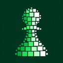
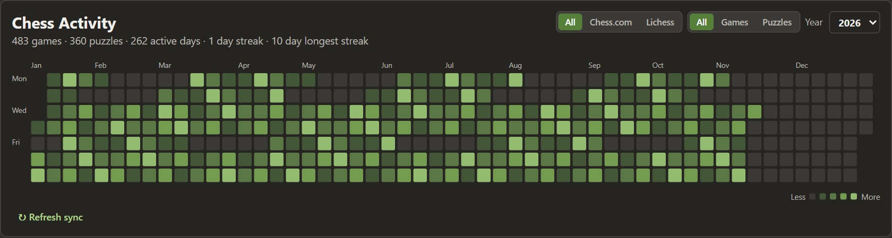
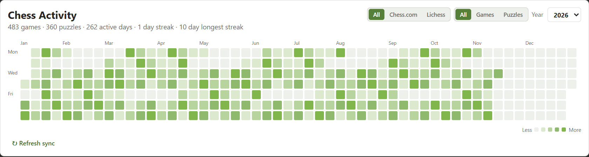
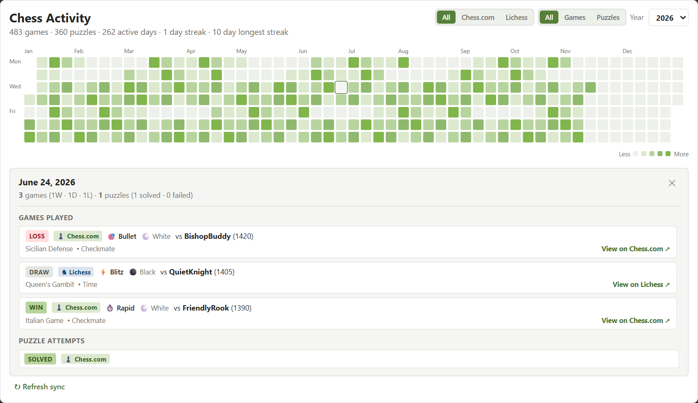
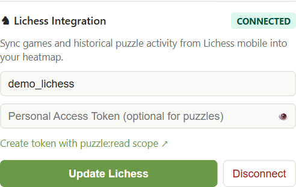

<p align="center">
  
</p>

<h1 align="center">Chess.com Activity Heatmap</h1>

<p align="center">
  A GitHub-style activity calendar for your chess games and puzzles, right on your Chess.com homepage.
</p>

<p align="center">
  <a href="https://github.com/phunguyen1006/chess-heatmap/releases/latest"><strong>Download the latest release</strong></a>
  · <a href="#installation">Installation</a>
  · <a href="#connecting-lichess">Connect Lichess</a>
  · <a href="https://github.com/phunguyen1006/chess-heatmap/issues">Report an issue</a>
</p>

<p align="center">
  <a href="https://github.com/phunguyen1006/chess-heatmap/actions/workflows/ci.yml"></a>
  <a href="https://github.com/phunguyen1006/chess-heatmap/releases"></a>
  <a href="LICENSE"></a>
  
</p>



See your activity at a glance, explore a single day, and bring Chess.com and Lichess into one view. The extension communicates directly with those services and keeps its cache in your browser.

## What you can do

- **See your year in squares.** The calendar shows active days, game and puzzle totals, and streaks.
- **Choose what to display.** Filter by Chess.com, Lichess, or both; switch between games and puzzles; and select a year.
- **Explore a day.** Hover for a summary or select a square to see available game results, openings, puzzle attempts, and links.
- **Bring Lichess activity in.** Connect a username for games and optionally a personal access token for puzzle activity.
- **Keep up automatically.** Lichess sync is checked when you open Chess.com and approximately every 30 minutes while the browser is running.
- **Track Chess.com rated puzzles.** Completed attempts are recorded locally as you solve them on the rated puzzles page.

## Preview

<table>
  <tr>
    <td align="center"><strong>Light appearance</strong></td>
    <td align="center"><strong>Dark appearance</strong></td>
  </tr>
  <tr>
    <td></td>
    <td></td>
  </tr>
</table>

<details>
<summary><strong>View a day's games and puzzles</strong></summary>
<br />



</details>

<details>
<summary><strong>View Lichess connection settings</strong></summary>
<br />



</details>

Screenshots show the actual extension with fictional local data. Both color palettes are shown; the current settings popup does not yet include a theme switch.

## Installation

The extension is distributed as an unpacked extension. You need a Chromium-based browser such as Google Chrome or Microsoft Edge.

1. Download `chess-heatmap-vX.X.X.zip` from the [latest release](https://github.com/phunguyen1006/chess-heatmap/releases/latest).
2. Extract the ZIP to a folder you intend to keep. The folder you select must contain `manifest.json`.
3. Open `chrome://extensions` in Chrome or `edge://extensions` in Edge.
4. Turn on **Developer mode**, select **Load unpacked**, and choose the extracted folder.
5. Open [chess.com/home](https://www.chess.com/home) and sign in. The heatmap appears below the play area. If prompted, enter your Chess.com username.

To update an unpacked installation, extract the new release to a permanent folder and load that folder, or replace the contents of your existing extension folder. Reload the extension from the browser's extensions page, then refresh Chess.com.

## Connecting Lichess

1. Select the extension icon in your browser toolbar to open its settings.
2. Enter your Lichess username. A token is optional for public games.
3. To include puzzle activity, [create a Lichess personal access token](https://lichess.org/account/oauth/token/create?scopes[]=puzzle:read) with the `puzzle:read` scope and enter it in the token field.
4. Select **Connect Lichess**. Use the platform selector above the heatmap to choose Chess.com, Lichess, or both.

The extension checks for a sync on Chess.com page loads and roughly every 30 minutes while the browser is running. Checks within 30 minutes of a successful sync are skipped. **Trigger Refresh** in the extension popup requests a manual Lichess sync; **Refresh sync** on the heatmap refreshes Chess.com data.

Each Lichess sync request retrieves at most 300 games and 300 puzzle attempts. Older history may not be imported; data already saved locally remains available. Chess.com rated puzzles are recorded when completed while the extension is active, so attempts from before tracking started may be unavailable.

## Privacy and storage

- Chess.com game history is fetched from its public API. Lichess game and puzzle activity is fetched directly from Lichess.
- Your Lichess token and extension settings are stored in `chrome.storage.local`; cached history is stored in IndexedDB on your device.
- Puzzle tracking observes the Chess.com rated puzzles page. Removing the extension or clearing its local data can remove its locally recorded history.
- Never share your personal access token in screenshots or issue reports. Revoke it on Lichess if it is exposed.

## Troubleshooting

**The heatmap is missing.** Check that the extension is enabled in `chrome://extensions` or `edge://extensions`, that Developer mode is on, and that site access allows it to run on Chess.com. Refresh [chess.com/home](https://www.chess.com/home); the heatmap is displayed on the homepage, not inside a live game. If you just updated the files, reload the extension first.

**Lichess puzzles are missing.** Check that a token with `puzzle:read` is saved, then use **Trigger Refresh**. The token is optional for games but needed for puzzle activity. Remember the per-request history limits above.

**Some Chess.com puzzles are missing.** Open the rated puzzles page with the extension enabled and complete a puzzle. Older attempts may not have been recorded locally.

**A different account is shown.** Open the extension popup, enter the intended Chess.com username, and select **Save**. Reconnect Lichess there if needed.

## Build from source

Requires Node.js and npm. CI uses Node.js 22.

```bash
git clone https://github.com/phunguyen1006/chess-heatmap.git
cd chess-heatmap
npm ci
npm run build
```

Load the generated `dist/` folder as an unpacked extension using the steps above.

| Command | Purpose |
| --- | --- |
| `npm run typecheck` | Check TypeScript types |
| `npm test` | Run the Vitest suite |
| `npm run build` | Build the service worker, popup, and content script |
| `npm run package` | Build a release ZIP and SHA-256 checksum |

The extension uses Manifest V3, React, TypeScript, Vite, esbuild, Chrome local storage, and IndexedDB. See [CONTRIBUTING.md](CONTRIBUTING.md) for development and pull request guidance.

## Contributing and license

Bug reports and pull requests are welcome. Please include your browser, extension version, steps to reproduce, and a screenshot with personal information removed when applicable. Open an [issue](https://github.com/phunguyen1006/chess-heatmap/issues) or see the [contribution guide](CONTRIBUTING.md).

Released under the [MIT License](LICENSE). This independent project is not affiliated with Chess.com or Lichess.
