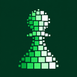
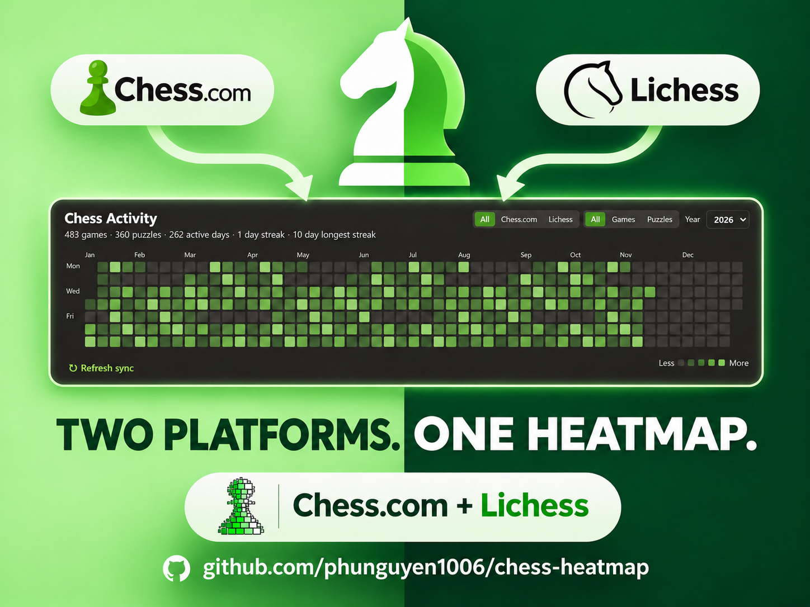
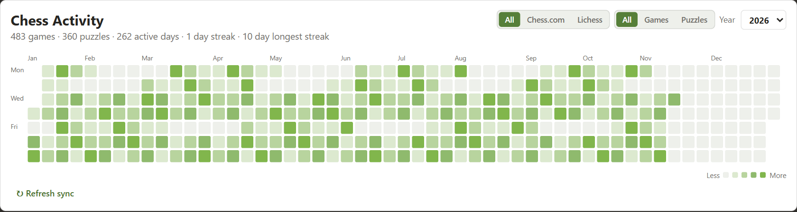
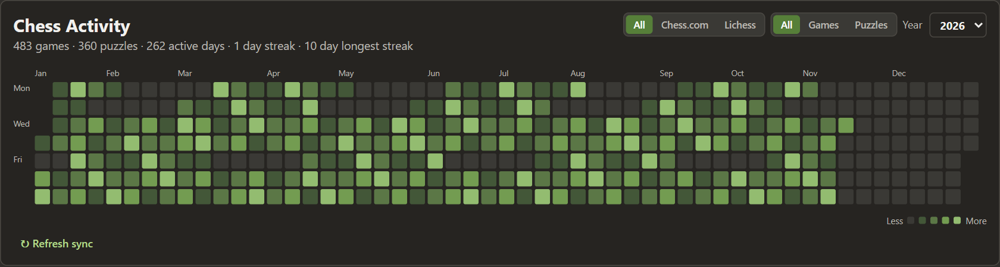
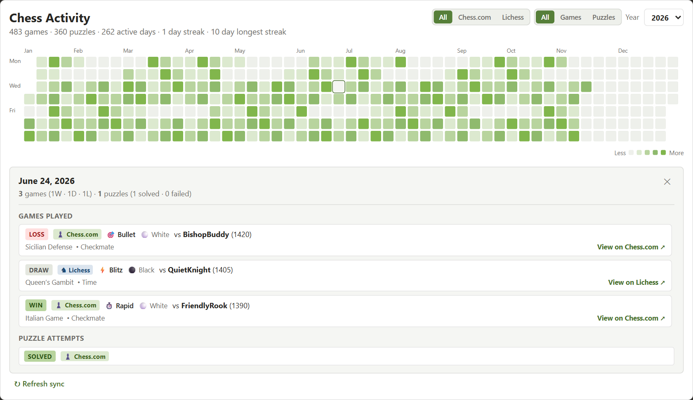
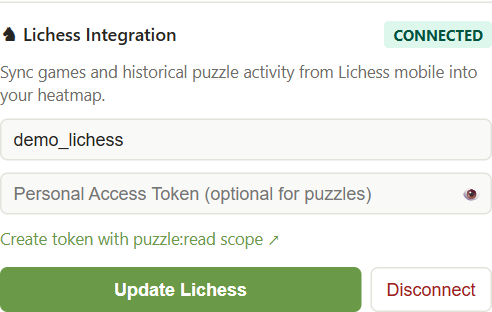

<p align="center">
  
</p>

<h1 align="center">Chess Activity Heatmap (Chess.com & Lichess)</h1>

<p align="center">
  A GitHub-style annual activity calendar for your chess games and puzzles — available in 3 editions: <strong>Combined (Chess.com + Lichess)</strong>, <strong>Chess.com Only</strong>, and <strong>Lichess Only</strong>.
</p>

<p align="center">
  <a href="https://github.com/phunguyen1006/chess-heatmap/releases/latest"><strong>Download the latest release (v1.4.0)</strong></a>
  · <a href="#choose-your-edition">Choose Your Edition</a>
  · <a href="#installation">Installation</a>
  · <a href="#connecting-lichess">Connect Lichess</a>
  · <a href="https://github.com/phunguyen1006/chess-heatmap/issues">Report an issue</a>
</p>

<p align="center">
  <a href="https://github.com/phunguyen1006/chess-heatmap/actions/workflows/ci.yml"></a>
  <a href="https://github.com/phunguyen1006/chess-heatmap/releases"></a>
  <a href="LICENSE"></a>
  
</p>



See your activity at a glance, explore a single day, and track your daily chess consistency on **Chess.com**, **Lichess.org**, or both combined into one unified view. The extension communicates directly with those services and keeps its cache locally in your browser.

## Choose your edition

Starting in **v1.4.0**, every release provides **3 standalone extension packages** so you can pick the exact setup you prefer:

| Edition | Release Archive | Unpacked Build Folder | Best For | Features & UI |
| --- | --- | --- | --- | --- |
| **Combined (Chess.com & Lichess)** | `chess-heatmap-vX.X.X.zip` | `dist/` | Players active on both platforms | Runs on both `chess.com` (`/home`) and `lichess.org` (`/` lobby & `/@/<username>` profile). Includes the `All \| Chess.com \| Lichess` platform filter, platform badges in day details, and dual-account settings in the popup. |
| **Chess.com Only** | `chesscom-heatmap-vX.X.X.zip` | `dist-chesscom/` | Dedicated Chess.com players | Requests permissions only for `chess.com`. Streamlined header without platform filter pills and a clean Chess.com-only settings popup. |
| **Lichess Only** | `lichess-heatmap-vX.X.X.zip` | `dist-lichess/` | Dedicated Lichess players | Requests permissions only for `lichess.org`. Streamlined header without platform filter pills and a clean Lichess-only settings popup. |

## What you can do

- **See your year in squares.** The calendar shows active days, game and puzzle totals, and current/longest streaks directly on **Chess.com** (`/home`) and **Lichess** (`/` lobby center column between Donate & Swag Store, and `/@/<username>` profile).
- **Choose what to display.** Switch between all activity, games only, or puzzles only; select a year; and (in the Combined edition) filter by Chess.com, Lichess, or both.
- **Explore a day.** Hover for a summary or select a square to see available game results, ratings, openings, puzzle attempts, and direct links.
- **Track rated puzzles live on both platforms.** Completed puzzle attempts are recorded locally as you solve them on the Chess.com rated puzzles page and on Lichess `/training` (no API token required for live tracking; deduplicated automatically if you also connect a Lichess token).
- **Import historical Lichess activity.** Connect your Lichess username for public games (with multi-page & historical year backfill) and optionally a personal access token (`puzzle:read`) to import past puzzle history.
- **Keep up automatically.** Lichess sync is checked when you open Chess.com or Lichess and approximately every 30 minutes while the browser is running.

## Preview

<table>
  <tr>
    <td align="center"><strong>Light appearance</strong></td>
    <td align="center"><strong>Dark appearance</strong></td>
  </tr>
  <tr>
    <td></td>
    <td></td>
  </tr>
</table>

<details>
<summary><strong>View a day's games and puzzles</strong></summary>
<br />



</details>

<details>
<summary><strong>View Lichess connection settings</strong></summary>
<br />



</details>

## Installation

The extension is distributed as an unpacked Chromium extension (Google Chrome, Microsoft Edge, Brave, etc.).

1. Download your preferred edition (`chess-heatmap-v1.4.0.zip`, `chesscom-heatmap-v1.4.0.zip`, or `lichess-heatmap-v1.4.0.zip`) from the [latest release](https://github.com/phunguyen1006/chess-heatmap/releases/latest).
2. Extract the ZIP to a permanent folder on your computer. The folder you select must contain `manifest.json`.
3. Open `chrome://extensions` in Chrome or `edge://extensions` in Edge.
4. Turn on **Developer mode**, select **Load unpacked**, and choose the extracted folder.
5. Open [chess.com/home](https://www.chess.com/home) or [lichess.org](https://lichess.org) (or your Lichess profile `lichess.org/@/<username>`). The heatmap will automatically detect your signed-in account or prompt you to connect your username.

To update an unpacked installation, extract the new release into your existing extension folder, reload the extension from the browser's extensions page, and refresh Chess.com or Lichess.

## Connecting Lichess

*(Available in the **Combined** and **Lichess Only** editions)*

1. Open [lichess.org](https://lichess.org) while signed in (the extension auto-detects your Lichess username), or click the extension icon in your browser toolbar to open its settings popup.
2. Enter your Lichess username. A token is **optional** — public games and live puzzles solved on `lichess.org/training` are tracked without a token.
3. To import past puzzle history from Lichess (including puzzles solved on mobile), [create a Lichess personal access token](https://lichess.org/account/oauth/token/create?scopes[]=puzzle:read) with the `puzzle:read` scope and paste it into the token field.
4. Select **Connect Lichess**.

When both a `puzzle:read` token and the live `/training` puzzle tracker are active, attempts are automatically deduplicated by puzzle ID and date while preserving live rating deltas.

## Privacy and storage

- Chess.com game history is fetched from its public API. Lichess game and puzzle activity is fetched directly from Lichess.
- Your Lichess token and extension settings are stored in `chrome.storage.local`; cached history is stored in IndexedDB on your device.
- Live puzzle tracking observes the Chess.com rated puzzles page and the Lichess `/training` page locally in your browser. Removing the extension or clearing its local data can remove locally recorded history.
- Never share your personal access token in screenshots or issue reports. Revoke it on Lichess if it is exposed.

## Troubleshooting

**The heatmap is missing.** Check that the extension is enabled in `chrome://extensions` or `edge://extensions`, that Developer mode is on, and that site access allows it to run on the target site. Refresh [chess.com/home](https://www.chess.com/home) or [lichess.org](https://lichess.org); the heatmap is displayed on the homepage/lobby and Lichess user profile, never inside a live game.

**Lichess puzzles are missing.** Live puzzles are recorded when completed on `lichess.org/training` with the extension enabled. To import older puzzle history, check that a token with `puzzle:read` is saved, then click **Trigger Refresh** in the popup.

**Some Chess.com puzzles are missing.** Open the Chess.com rated puzzles page with the extension enabled and complete a puzzle. Older attempts from before tracking started are not provided by Chess.com's public API.

**A different account is shown.** Open the extension popup, enter the intended username, and save.

## Build from source

Requires Node.js and npm. CI uses Node.js 22.

```bash
git clone https://github.com/phunguyen1006/chess-heatmap.git
cd chess-heatmap
npm ci
npm run build
```

`npm run build` generates all 3 unpacked folders ready to load in `chrome://extensions`:
- `dist/` — **Combined** (Chess.com & Lichess)
- `dist-chesscom/` — **Chess.com Only**
- `dist-lichess/` — **Lichess Only**

| Command | Purpose |
| --- | --- |
| `npm run typecheck` | Check TypeScript types |
| `npm test` | Run the Vitest suite |
| `npm run build` | Build all 3 unpacked editions (`dist/`, `dist-chesscom/`, `dist-lichess/`) |
| `npm run package` | Package all 3 release ZIPs and `SHA256SUMS.txt` into `releases/` |

The extension uses Manifest V3, React, TypeScript, Vite, esbuild, Chrome local storage, and IndexedDB. See [CONTRIBUTING.md](CONTRIBUTING.md) for development and pull request guidance.

## Contributing and license

Bug reports and pull requests are welcome. Please include your browser, extension version, edition, steps to reproduce, and a screenshot with personal information removed when applicable. Open an [issue](https://github.com/phunguyen1006/chess-heatmap/issues) or see the [contribution guide](CONTRIBUTING.md).

Released under the [MIT License](LICENSE). This independent project is not affiliated with Chess.com or Lichess.
